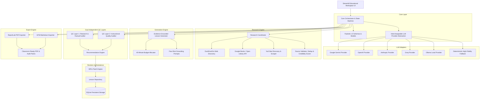

# LessonForge AI — System Architecture Specification

> **System**: LessonForge AI  
> **Architecture Pattern**: Decoupled Layered Architecture with Pluggable Provider & Dual-Auditor Pattern  
> **Version**: 1.0.0  

---

## 1. System Overview & Architecture Diagram

LessonForge AI is structured into strictly decoupled tiers ensuring high cohesion, low coupling, testability, and deterministic failure isolation.



---

## 2. Component Deconstruction

### 2.1 Core Orchestration & State Machine (`core/`)
- **`schemas.py`**: Pydantic models with runtime validations:
  - `LessonInput`: Title, Objective, LearnerLevel (Beginner, Intermediate, Advanced), Prerequisites, DurationMinutes (default 45).
  - `ResearchSource`: SourceType (Web, Book, YouTube), Title, URL, Authors/Channel, Snippet, CredibilityScore, RetrievalDate, ProvenanceStatus (`DISCOVERED`, `RETRIEVED`, `VERIFIED`).
  - `TimedAgendaItem`: Section title, duration in minutes, cognitive focus.
  - `LessonPlan`: Complete structured schema with total duration assertion (`sum == 45`), sections, examples, activities, knowledge checks with answer keys, references, and supplementary videos.
  - `QCReport`: Scores, findings, severity badges (`CRITICAL`, `MAJOR`, `MINOR`), evidence citations, and actionable recommendations.
  - `Recommendation`: Unique ID, target section, issue description, suggested replacement, status (`PENDING`, `ACCEPTED`, `REJECTED`, `APPLIED`).
- **`llm_provider.py`**: Unified provider interface `LLMProvider` with standardized JSON completion & text generation:
  - Supports Google Gemini (`gemini-2.5-flash`, `gemini-1.5-pro`), OpenAI (`gpt-4o`, `gpt-4o-mini`), Anthropic (`claude-3-5-sonnet`), Groq (`llama-3.3-70b`), Ollama (`llama3`).
  - Automatically activates **Deterministic Offline Fallback Engine** if no API keys are provided or during network partition.
- **`orchestrator.py`**: State machine managing:
  `DRAFT_INPUT` $\rightarrow$ `RESEARCHING` $\rightarrow$ `GENERATING` $\rightarrow$ `QC_AUDITING` $\rightarrow$ `REVIEW_READY` $\rightarrow$ `REVISION_IN_PROGRESS` $\rightarrow$ `FINALIZED`.

### 2.2 Multi-Modal Research Engine (`research/`)
1. **Web Research (`web_research.py`)**:
   - Uses `duckduckgo-search` (`DDGS`) to query high-authority educational domains, RFCs, official specifications, and academic portals.
   - Extracts title, URL, snippet, published date.
   - Deduplicates URLs and filters out spam/unverified blogs.
2. **Book Research (`book_research.py`)**:
   - Queries Google Books API v1 (`volumes?q=...`) with fallback to Open Library REST API.
   - Captures title, authors, publisher, publication year, ISBN, preview/info link, and editorial descriptions.
   - **Integrity Rule**: Never simulates or fabricates internal chapter contents for unread books.
3. **YouTube Research (`youtube_research.py`)**:
   - Discovers instructional and conceptual videos via DDGS video search and YouTube Data API / scraping.
   - Validates URL syntax (`https://www.youtube.com/watch?v=...`), channel name, duration, and educational relevance.
4. **Source Validator & Credibility Scoring (`source_validator.py`)**:
   - Assigns a credibility index (0.0 to 1.0) based on domain reputation:
     - Tier 1 (1.0): Standards bodies (`ietf.org`, `w3.org`, `rfc-editor.org`), official docs (`developer.mozilla.org`, `python.org`).
     - Tier 2 (0.85): University domains (`.edu`), leading academic textbooks (O'Reilly, Addison-Wesley, MIT Press).
     - Tier 3 (0.70): Reputable industry publications, high-tier educational YouTube channels.
     - Tier 4 (<0.50): Personal blogs, unverified forums (flagged or excluded).

### 2.3 Grounded Lesson Generation Engine (`generation/`)
- Injects validated research sources as numbered context blocks `[REF 1]`, `[REF 2]`.
- Implements prompt-level **Citation Grounding**: Every technical claim must reference an available research artifact.
- Enforces strict 45-minute lesson duration allocation across components:
  1. *Lesson Introduction & Hook* (~5 min)
  2. *Core Conceptual Foundations* (~12 min)
  3. *In-Depth Worked Technical Examples* (~10 min)
  4. *Real-World Industry Applications* (~5 min)
  5. *Hands-On Guided Activity / Lab* (~8 min)
  6. *Lesson Summary & Next Steps* (~5 min)
  - Total = **45 minutes** exact.
  - Plus dedicated *Knowledge Checks (Multiple Choice & Conceptual with full answer keys)*.

### 2.4 Independent Dual-Auditor Quality Control System (`quality_control/`)
To guarantee true objectivity, the two QC layers are executed as **two completely separate auditing engines** with zero shared evaluator state:

1. **QC Layer 1: Research & Factual Accuracy Auditor (`research_auditor.py`)**:
   - Role: Forensic Fact-Checker and Research Verification Officer.
   - Input: Generated Lesson Plan + Retrieved Research References Pool.
   - Methodology:
     - Claim extraction $\rightarrow$ Source cross-examination $\rightarrow$ Evidence verification.
     - Identifies: Unsupported claims, factual distortions, misleading generalizations, hallucinated sources, contradiction with established standards.
     - Evaluates research depth and flags knowledge gaps.
   - Output: `ResearchQCAuditReport`:
     - Factual Accuracy Score (0-100).
     - Severity Matrix: Critical, Major, Minor findings.
     - Evidence Quote vs Claim comparison.
     - Remediation suggestions.
     - Source Reliability Table.

2. **QC Layer 2: Instructional Quality Auditor (`instructional_auditor.py`)**:
   - Role: Senior Curriculum Specialist and Pedagogical Evaluator.
   - Input: Generated Lesson Plan + Learning Objective + Target Audience Level.
   - Methodology:
     - Evaluates against proven pedagogical frameworks (Bloom's Revised Taxonomy, Sweller's Cognitive Load Theory, Active Learning Index).
     - Zero overlap with factual checking: Focuses purely on teaching efficacy.
     - Checks: Alignment to stated objective, clarity of explanation, scaffolding and logical sequence, quality and depth of examples, student activity engagement, assessment rigor, and realistic timing.
   - Output: `InstructionalQCAuditReport`:
     - Instructional Quality Score (0-100).
     - Criterion breakdown (Objective Alignment /25, Clarity & Sequencing /20, Examples & Practice /20, Guided Activity /15, Assessment Rigor /10, Pacing /10).
     - Missing learning components.
     - Concrete revision suggestions for specific sections.

### 2.5 Recommendation & Revision Engine (`recommendation_engine.py`)
- Ingests issues from both QC audits.
- Normalizes them into atomic, actionable `Recommendation` cards.
- Allows the instructor to:
  - **Accept** (schedule for automated patching or revision).
  - **Reject** (discard with optional rationale).
  - **Modify** (edit the suggested change directly).
- Automated Patch Engine:
  - Applies accepted changes to create a new revision of the `LessonPlan`.
  - Non-destructive: The original version is preserved in the database.
  - Side-by-side visual diff viewer highlights changed paragraphs and sections.
  - Re-run capability: Instructor can re-trigger QC 1, QC 2, or both on the revised draft.

### 2.6 Persistence & Repository Layer (`storage/`)
- Relational schema in SQLite (`lessons.db`):
  - `lessons`: ID, Title, Objective, LearnerLevel, TotalDuration, Status, CreatedAt, UpdatedAt.
  - `lesson_versions`: VersionNumber, LessonID, PlanJSON, Timestamp, Author ('AI' or 'Instructor').
  - `research_sources`: SourceID, LessonID, SourceType, Title, URL, Authors, MetadataJSON.
  - `qc_reports`: ReportID, LessonID, VersionNumber, Layer ('FACTUAL' or 'INSTRUCTIONAL'), Score, ReportJSON, CreatedAt.
  - `recommendations`: RecID, ReportID, SectionName, Issue, Suggestion, Status, CreatedAt.
- Guaranteed ACID safety, automatic rollback on write failures.

### 2.7 Export Engine (`export/`)
1. **PDF Exporter (`pdf_exporter.py`)**:
   - Built using ReportLab with custom canvas flowables.
   - Features:
     - Professional educational title cover page.
     - Executive lesson metadata header (Title, Target Audience, 45-min duration breakdown).
     - Formatted agenda table with durations and learning objectives.
     - Clean typography (Helvetica / Times-Roman with styled headings and callouts).
     - Boxed callouts for "Hands-On Activity" and "Knowledge Checks".
     - Complete reference bibliography with clickable URLs.
     - Dedicated appendable QC 1 and QC 2 audit certificate pages.
2. **Markdown Exporter (`markdown_exporter.py`)**:
   - Generates GitHub-Flavored Markdown (`.md`) formatted for LMS platforms (Canvas, Moodle, GitHub Classroom).
   - Generates standalone audit reports (`QC_FACTUAL_REPORT.md` and `QC_INSTRUCTIONAL_REPORT.md`).

---

## 3. Data Flow

```
[User Input: Title & Objective]
         │
         ▼
[Research Engine: DDGS + Google Books + YouTube]
         │ (Sources with Credibility Scores)
         ▼
[Lesson Generator (45-min Grounded Synthesis)]
         │ (Draft Lesson Plan v1)
    ┌────┴──────────────────────────┐
    ▼                               ▼
[QC Layer 1: Factual Auditor]  [QC Layer 2: Instructional Auditor]
    │                               │
    └────┬──────────────────────────┘
         ▼
[Unified Recommendation Engine]
         │ (Instructor Review & Decision)
         ▼
[Lesson Editor / Patch Engine]
         │ (Revised Lesson Plan v2)
         ▼
[SQLite Storage & Multi-Format Exporter (PDF / MD)]
```
